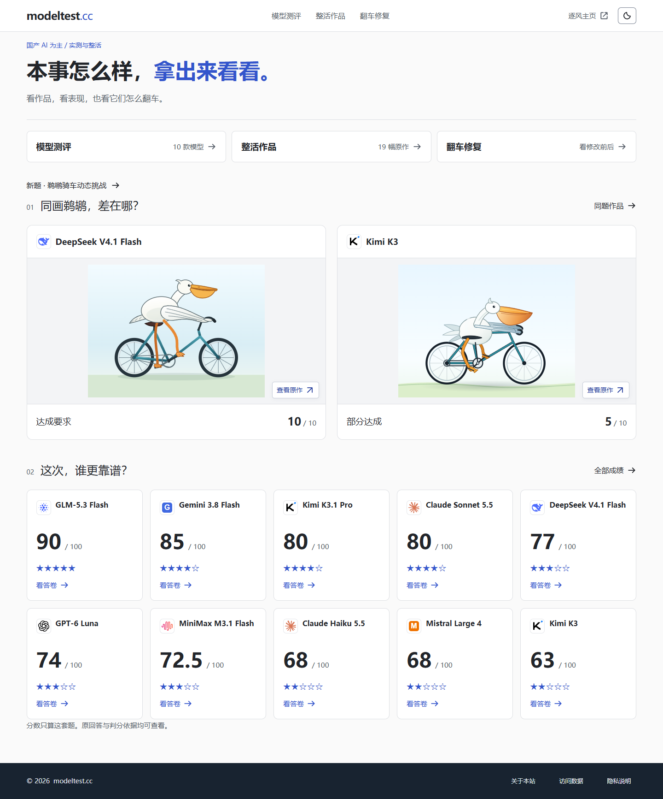

# ModelTest · AI 模型测评与整活

**把模型能力变成普通人看得懂的题目、作品和翻车现场。**

[在线体验](https://modeltest.cc/) · [模型成绩](https://modeltest.cc/#checkup/results) · [同题作品](https://modeltest.cc/#checkup/works) · [测试与评分](docs/EVALUATION.md)



这里既做测评，也做整活：洗车到底该走过去还是开车？账单里到底有几份辣椒炒肉？让不同模型画一只骑自行车的鹈鹕，会交出什么作品？

相比只展示一个 benchmark 分数，ModelTest 更关注题目、真实回答、可见作品，以及具体为什么得分或扣分。分数只描述本站这套题，不代表模型的全部能力。

## 三个栏目

| 栏目 | 看什么 |
| --- | --- |
| 模型测评 | 八项百分制成绩、模型详情、同题回答和并排对比 |
| 整活作品 | 斑马、鹈鹕等模型原作，支持放大及查看原回答 |
| 翻车修复 | 具体错误，以及已有的文字修改前后对照；缺少返工答卷的项目会明确标记 |

截至本次源码快照，第一期有 **10 款模型的真实答卷**。新一期挑战题单独版本管理；动态鹈鹕页中的播放器是本站制作的题意示范，**不是模型测试成绩**。模型名称与请求条件按实际服务商记录展示。

## 本地运行

需要 Python 3.12+。仅看前端无需安装依赖或配置 API 密钥：

```bash
git clone https://github.com/mzh-nuist/modeltest.git
cd modeltest
python -m http.server 8765 --bind 127.0.0.1 --directory dist
```

打开 <http://127.0.0.1:8765/>。静态模式下访客统计接口不可用，页面不会编造访问量。

需要完整的本地统计预览时，再安装 Node.js 22.13+：

```bash
python scripts/build_worker.py
node scripts/preview_worker.mjs
```

打开 <http://127.0.0.1:8766/>。统计数据保存在本地 SQLite，和线上数据库分开。

## 开发与测试

前端使用原生 JavaScript、CSS 和 HTML；采集与评分运行器使用 Python 标准库；线上部署到 Cloudflare Pages，访客统计由 Worker + D1 提供。

```bash
node --test tests/*.test.mjs
python -X utf8 -m unittest discover -s tests -p "test_*.py"
```

测试只使用本地夹具和模拟服务，不需要真实 API 密钥，不产生模型调用费用。GitHub Actions 会在推送和 Pull Request 时运行同一套离线检查。

```text
dist/          网站源码、静态资源和已公开答卷
datasets/      公开题目与题库目录
runner/        采集、预算控制、评分和导出
worker/        访客统计与资源服务
drizzle/       统计数据库结构
scripts/       构建、导出、校验和本地预览
tests/         前端与运行器测试
docs/          评分说明、部署方法及第三方素材来源
```

[采集运行器](runner/README.md) · [开发说明](docs/DEVELOPMENT.md) · [独立部署](docs/DEPLOYMENT.md)

## 数据与边界

- 已公开答卷与演示数据分开存放；`demo`、`offline` 数据用于验证程序，不当作模型实测。
- 原始回答、请求条件和判分依据可以查看。规则、人工复核、未测或待评状态分别记录。
- 改题或改评分协议时建立新版本，不把不同条件下的成绩拼成一个“最高分”。
- 账单是有争议的整活题，按出题者约定答案计分，不足以概括模型的整体识图能力。
- 模型输出不作为可信网页直接执行；SVG 经检查后作为图片展示。动态示意播放器只运行本站代码。
- 仓库不包含 API 密钥、账户余额、访客原始数据库、私有原始日志或封存题库。新增真实模型调用需要自行配置服务商与预算。

## 许可与作者

项目代码使用 [MIT License](LICENSE)。第三方品牌图标保留[原许可与来源](docs/BRAND-ASSETS.md)，品牌名称和商标归各自权利人所有。示例账单、第三方材料及模型答卷不因本仓库的代码许可而获得额外权利授权。

作者：[逐风03](https://github.com/mzh-nuist) · [X / @03AIer](https://x.com/03AIer)
